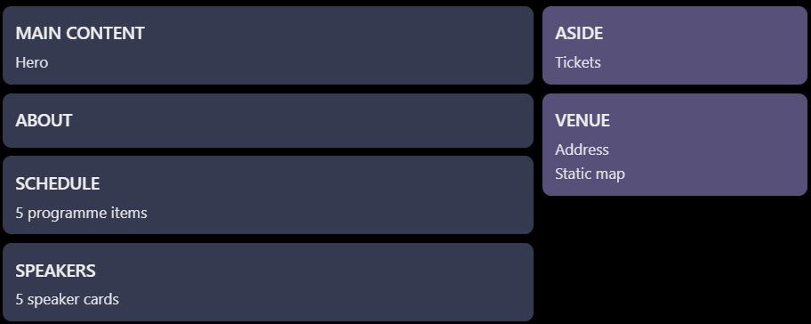

# Inlämningsuppgift
Här är repot för din inlämningsuppgift.

Om filerna:
- `.gitignore` - Denna fil används för att ignorera/exkludera vissa systemfiler som inte behöver komma med i versionshanteringen. En sådan bör man alltid ha i sitt repo.
- `index.html` - För att sidan ska kunna publiceras automatiskt på GitHub Pages är det viktigt att filen heter `index.html` med ett litet `i` i början.
- I mappen `.github` finns ett script som automatiskt publicerar sidan till GitHub Pages.
- I mappen `.github` finns även instruktioner för hur CoPilot ska ge feedback på koden.
- Det går bra att redigera denna README-fil.

Din uppgift är att ta fram en (fiktiv) konferens-sida. Konferens-sidan ska innehålla följande information:

Schema/program med tid, programpunktens "titel", talarens namn och en kort beskrivning av innehållet på "föreläsningen". Du ska ha med minst 5 programpunkter.
Ett "galleri" över talarna på konferensen. Du ska ha med minst 5 talare.
Biljettnivåer, här får du hitta på egna. T.ex. "Student", "After Work", "Utställare", osv. Du ska ha minst 3 biljettnivåer.
Det ska finnas praktisk information, t.ex. adress, karta (en statisk bild, ska ej vara en interaktiv karta), osv.
Du får välja tema själv på konferensen, det kan handla om blockchain, crypto, katter, astrologi…
Det går jättebra att använda AI för att slutföra uppgiften. Lägg fokus på att lära dig förstå begrepp och koncept inom CSS under tiden som du jobbar med uppgiften, så att du blir effektiv i din promptning.

Tips/övning! Sätt en "budget" för dig själv, t.ex. att du har max 10 promptar på dig för att slutföra uppgiften. Därefter måste du "koda allt själv". Fundera på hur långt du har kommit efter t.ex. 3 promptar, och om du behöver läsa på om något/förstå något, för att kunna slutföra uppgiften på resterande 7 promptar.

Det räcker med en s.k. "one-pager" för uppgiften, du behöver inte skapa separata sidor.

Kravlista
Du ska använda ett "ramverk" eller en pre-processor för att ta fram sidans CSS, t.ex. Sass eller Tailwind.
Även om du använder Tailwind eller motsvarande, ska du skriva minst 5 selektorer själv.
Du ska använda minst 3 "avancerade" CSS-selektorer, t.ex.:
barn- eller syskonselektorer (child & sibling combinators)
pseudo-klasser (pseudo classes, structural pseudo classes)
pseudo-element (pseudo elements)
attribut-selektorer
Du ska ha med minst en CSS-animation
Det ska finnas stöd för ljust/mörkt tema i grundläggande form, dvs. du demonstrerar att du vet hur du anpassar sidan till ljust/mörkt läge. Det behöver inte vara perfekt och allt behöver inte vara på plats. Det räcker med prefers-color-scheme, ingen JavaScript/toggle-knapp krävs. Du kan testa tema via DevTools så behöver du inte ändra i ditt operativsystem.
Det ska finnas med minst 1 hover-effekt, t.ex. om man för musen över ett talarkort så ska det visas någon extra information. Det kan t.ex. vara en annan bild, kontaktuppgifter, att bilden blir svartvit, eller något annat. Effekten ska även fungera vid tangentbordsnavigering.
Sidan ska vara responsiv på mobil, tablet och desktop.
Det ska finnas en navigation/meny som hoppar till rätt sektion på sidan, t.ex. om jag klickar på "Talare" i menyn så ska jag scrollas ner till sektionen som visar alla talare.

# CHAIN REACTION – Web3 Conference

A fictional Web3 and Blockchain conference website exploring innovation, regulation, security, and the future of decentralized technologies.

**Project type:** One-page conference website  
**Status:** In development  
**Technologies:** HTML5, Sass (SCSS)  
**Live Demo:** To be added

---

## 1. Project Overview

### About the Project

CHAIN REACTION is a fictional conference dedicated to Web3 and Blockchain technologies. The website presents the conference programme, speakers, ticket options, and practical visitor information.

The conference explores both the opportunities and challenges of decentralized technologies, including:

- Blockchain innovation and decentralization
- MiCA and European crypto regulation
- Blockchain security and smart contract vulnerabilities
- Cryptocurrency exchange risks and industry controversies
- DeFi and the future of Web3

### Project Goals

- Build a responsive, accessible one-page conference website.
- Apply semantic HTML5 correctly.
- Develop styling with Sass (SCSS).
- Practise advanced CSS selectors and animations.
- Understand responsive layouts using Flexbox and CSS Grid.
- Implement basic light and dark themes.
- Meet the accessibility and technical requirements of the assignment.

---

## 2. Design Concept

**Concept:** Editorial Web3 / Blockchain Conference

**Visual direction:**

- Bold editorial typography
- Cream, black, and acid green colour palette!!!
- Contemporary layouts and geometric details
- Clear content hierarchy
- Responsive speaker and ticket presentations

**Design decisions:** To be completed.




### wireframe

```text
┌──────────────────────────────────────────────┐
│                    HEADER                    │
│                                              │
│  LOGO             NAVIGATION                  │
│                                              │
├──────────────────────────────────────────────┤
│                                              │
│                     MAIN                     │
│                                              │
│  ┌────────────────────────┐ ┌──────────────┐ │
│  │                        │ │              │ │
│  │         HERO           │ │    ASIDE     │ │
│  │                        │ │              │ │
│  ├────────────────────────┤ │   TICKETS    │ │
│  │                        │ │              │ │
│  │         ABOUT          │ ├──────────────┤ │
│  │                        │ │              │ │
│  ├────────────────────────┤ │    VENUE     │ │
│  │                        │ │              │ │
│  │       SCHEDULE         │ │   ADDRESS    │ │
│  │                        │ │   MAP        │ │
│  ├────────────────────────┤ │              │ │
│  │                        │ │              │ │
│  │       SPEAKERS         │ │              │ │
│  │                        │ │              │ │
│  └────────────────────────┘ └──────────────┘ │
│                                              │
├──────────────────────────────────────────────┤
│                    FOOTER                    │
└──────────────────────────────────────────────┘
```

---

## 3. Website Structure

The website is organised as a single page with the following sections:

| Section | Content |
| ---------|---------|
| Hero | Conference identity, date and main call to action |
| About | Conference introduction and topics |
| Speakers | At least five fictional speakers |
| Programme | At least five talks with times, titles, speakers and descriptions |
| Tickets | At least three ticket categories |
| Practical Information | Venue, address, directions and static map |
| Footer | Contact and additional information |

---

## 4. Technologies and Tools

### Technologies

- HTML5
- Sass (SCSS)
- CSS3
- CSS Flexbox
- CSS Grid
- CSS animations and media queries

### Development Tools

- Visual Studio Code
- Git and GitHub
- GitHub Copilot (assistance when needed)
- Chrome DevTools
- Lighthouse
- W3C HTML Validator
- Prettier

**Tools and versions:** To be completed.

---

## 5. Code Organisation and Conventions

### Project Structure

```text

bcu26d-inl-2-konferens-cameloasa/
│
├── .github/
│
├── images/
│
├── scss/
│   ├── abstracts/
│   │   ├── _variables.scss
│   │   └── _mixins.scss
│   │
│   ├── base/
│   │   ├── _reset.scss
│   │   ├── _typography.scss
│   │   └── _base.scss
│   │
│   ├── layout/
│   │   ├── _header.scss
│   │   ├── _navigation.scss
│   │   ├── _main-layout.scss
│   │   └── _footer.scss
│   │
│   ├── components/
│   │   ├── _hero.scss
│   │   ├── _schedule.scss
│   │   ├── _speakers.scss
│   │   ├── _tickets.scss
│   │   └── _venue.scss
│   │
│   └── main.scss
│
├── css/
│   └── main.css
│
├── index.html
├── .gitignore
└── README.md
```

To be completed when the final folder and file structure is established.

### CSS Naming Convention

**Convention:** To be confirmed (proposed: kebab-case).

### HTML Architecture

```text
body
├── header.site-header
│   ├── a.site-logo
│   └── nav.site-nav
│       └── ul.site-nav-list
├── main.page-layout
│   ├── div.main-content
│   │   ├── section.hero
│   │   ├── section.about
│   │   ├── section.schedule
│   │   └── section.speakers
│   └── aside.sidebar
│       ├── section.tickets
│       └── section.venue
└── footer.site-footer
```

```text
HEADER
└── NAV

MAIN
├── MAIN CONTENT
│   ├── HERO
│   ├── ABOUT
│   ├── SCHEDULE
│   └── SPEAKERS
│
└── ASIDE
    ├── TICKETS
    └── VENUE
        ├── ADDRESS
        └── STATIC MAP

FOOTER
```

| Element | Technology  |
|---|---| 
Header + navigation	Flexbox
Main + Aside	Flexbox
Hero	Flexbox
About	Normal document flow
Schedule	Flexbox
Speakers	CSS Grid
Tickets	SCSS + form controls
Venue	Flexbox
Footer	Flexbox

### SCSS Architecture

```text
├── scss/
│   ├── abstracts/
│   │   ├── _variables.scss
│   │   └── _mixins.scss
│   │
│   ├── base/
│   │   ├── _reset.scss
│   │   ├── _typography.scss
│   │   └── _base.scss
│   │
│   ├── layout/
│   │   ├── _header.scss
│   │   ├── _navigation.scss
│   │   ├── _main-layout.scss
│   │   └── _footer.scss
│   │
│   ├── components/
│   │   ├── _hero.scss
│   │   ├── _schedule.scss
│   │   ├── _speakers.scss
│   │   ├── _tickets.scss
│   │   └── _venue.scss
│   │
│   └── main.scss
│
├── css/
│   └── main.css
```

To be documented after the SCSS partials and import structure have been implemented.

### Code Formatting

Prettier configuration and formatting rules will be documented here.

---

## 6. Accessibility and Responsive Design

The website aims to follow WCAG 2.2 Level AA principles.

### Accessibility

- Semantic HTML landmarks
- Correct heading hierarchy
- Keyboard navigation
- Visible custom focus indicators using `:focus-visible`
- Accessible hover and focus interactions
- Sufficient colour contrast
- Appropriate image alternative text
- Reduced-motion support

### Responsive Testing

The website will be tested at:

| Viewport | Width |
|---|---:|
| Mobile | 320px |
| Tablet | 768px |
| Laptop | 1024px |
| Desktop | 1440px |

Additional browser zoom testing:
- 200% zoom
- 300% zoom at 1440px viewport width

---

## 7. Light and Dark Themes

The website will support the user's system colour preference through `prefers-color-scheme`.

JavaScript-based theme switching is not required for this assignment.

Implementation and testing notes: To be completed.

---

## 8. Performance and Quality Assurance

### HTML Validation
The HTML will be checked using the W3C Markup Validation Service.

**Result:** To be completed.

### Lighthouse Requirements

Tests will be performed in mobile mode.

| Category | Required Score | Actual Score |
|---|---:|---:|
| Accessibility | 100 | Pending |
| Best Practices | 95 | Pending |
| Performance | 90 | Pending |

A screenshot of the final Lighthouse results will be added here.

### Additional Testing

- No horizontal scrolling
- No overlapping or clipped content
- Keyboard navigation testing
- Colour contrast testing
- Browser console inspection
- Responsive layout testing

---

## 9. Git Workflow

The project will be developed incrementally and documented through meaningful commits.

**Commit convention:** Conventional Commits.

Examples:

- `feat: add conference hero section`
- `feat: create responsive speaker cards`
- `style: implement dark theme colours`
- `fix: improve mobile navigation`
- `docs: document accessibility testing`

The Git history will reflect the actual development process.

---

## 10. AI Usage and Learning Process

### AI Tools

- ChatGPT
- GitHub Copilot in Visual Studio Code, when needed
- Google Stitch [https://stitch.withgoogle.com/]

### How AI Was Used

To be completed throughout the project.

- Google Stitch [https://stitch.withgoogle.com/] was used for design prototype

### Learning Outcomes

To be completed with practical examples of concepts learned and implemented independently.

### Challenges and Knowledge Gaps

To be documented honestly during development.

### Critical Reflection

A final reflection on:

- What worked well
- What could be improved
- Which concepts required additional study
- How AI assistance influenced the development process
- What I would do differently in a future project

---

## 11. Final Project Checklist

- [ ] All assignment requirements fulfilled
- [ ] Semantic HTML validated with zero errors
- [ ] SCSS compiled successfully
- [ ] Prettier formatting applied
- [ ] CSS naming convention documented
- [ ] At least five advanced CSS selectors implemented
- [ ] CSS animation implemented
- [ ] Reduced-motion support implemented
- [ ] Light and dark themes tested
- [ ] Hover and keyboard focus interactions tested
- [ ] Responsive layouts tested at all required widths
- [ ] 200% and 300% zoom tested
- [ ] WCAG AA contrast checked
- [ ] Lighthouse scores meet requirements
- [ ] Lighthouse screenshot added
- [ ] Git history meets assignment requirements
- [ ] AI usage and learning reflection documented
- [ ] `.gitignore` included

---

## 12. Credits and Disclaimer

CHAIN REACTION is a fictional conference created as part of an educational web development assignment.

All speaker profiles, programme details, ticket information and event details are fictional unless otherwise stated.

External resources, fonts and image sources will be credited here.

## Picture of speakers


tree /F
