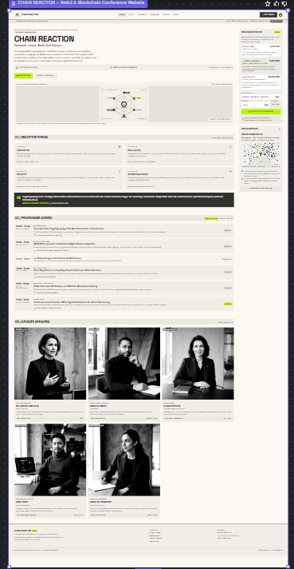
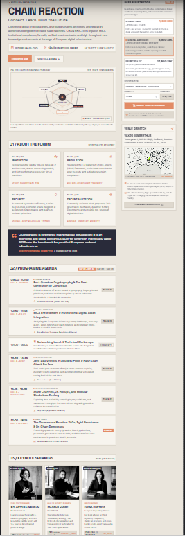
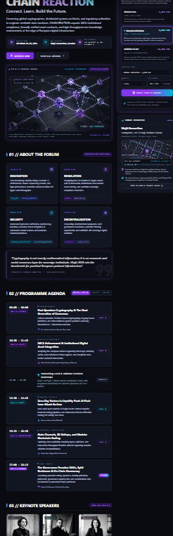
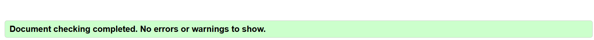
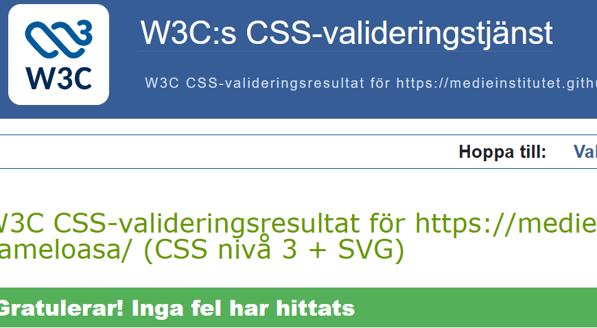
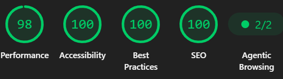
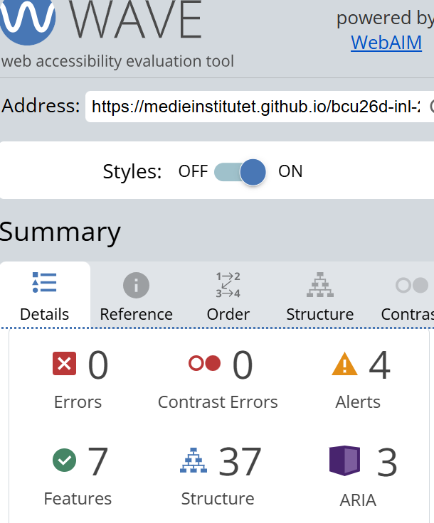
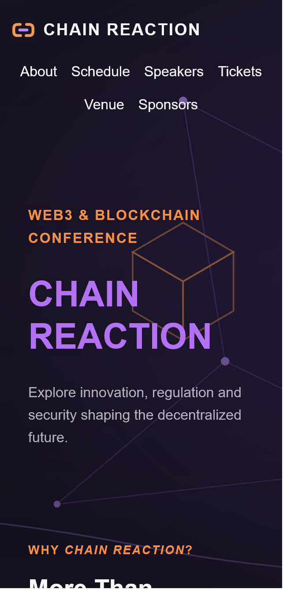

# CHAIN REACTION – Web3 Conference

## Quick Link

[View Live Project](https://medieinstitutet.github.io/bcu26d-inl-2-konferens-cameloasa/)

A fictional Web3 and Blockchain conference website exploring innovation, regulation, security, and the future of decentralized technologies.

**Project type:** One-page conference website  
**Status:** Completed  
**Technologies:** HTML5, Sass (SCSS), CSS

---

## 1. Project Overview

### About the Project

CHAIN REACTION is a fictional one-day conference dedicated to Web3 and Blockchain technologies. The website presents the conference programme, speakers, ticket options, and practical visitor information.

The conference explores both the opportunities and challenges of decentralized technologies, including:

- Blockchain innovation and decentralization
- MiCA and European crypto regulation
- Blockchain security and smart contract vulnerabilities
- Cryptocurrency exchange risks and industry controversies
- DeFi and the future of Web3

### Features

- **Responsive Layout** – adapts to desktop, tablet, and mobile screen sizes.
- **Two-Column Structure** – organizes the main content and sidebar on larger screens, with a stacked layout on smaller devices.
- **Semantic HTML5** – uses semantic elements to create a meaningful page structure.
- **Navigation Menu** – provides links to the main sections of the conference website.
- **About Section** – introduces the conference and its focus on Web3 and Blockchain technologies.
- **Schedule Section** – presents the one-day conference programme, including session times, titles, speakers, and descriptions.
- **Speakers Section** – introduces five fictional speakers and their conference topics.
- **Ticket Options** – presents three ticket levels: Student Pass, Standard Pass, and VIP Pass.
- **Venue Information** – provides the conference venue address and a static map.
- **Sponsors Information** – provides the conference sponsors.
- **Light and Dark Themes** – adapts the website's color scheme to the user's system preference.
- **CSS Animations** – adds subtle visual effects while respecting reduced-motion preferences.
- **Flexbox and CSS Grid** – organize page layouts and speaker cards.

---

## 2. Design Concept

**Concept:** Editorial Web3 / Blockchain Conference

**Visual direction:**

- Bold editorial typography
- Dark and light themes with purple and orange accent colours
- Contemporary layouts and geometric details
- Clear visual hierarchy and consistent spacing
- Responsive speaker, ticket, and sponsor presentations
- Subtle animations and accessible interactive states

**Design decisions:**

- A two-column desktop layout separates the main conference content from the sidebar.
- Flexbox is used for the main page layout and content alignment.
- CSS Grid is used for the speaker gallery.
- The sidebar groups ticket, venue, and sponsor information.
- A dark theme is the default, with a light theme based on the user's system preference.
- Responsive breakpoints adapt the layout to desktop, tablet, and mobile screens.
- The visual design uses reusable Sass variables and CSS custom properties for consistent styling.

### Design Prototypes







### Wireframe

```text
┌──────────────────────────────────────────────┐
│ LOGO       HEADER          NAVIGATION        │
│                                              │
│                                              │
│                                              │
├──────────────────────────────────────────────┤
│                                              │
│                     MAIN                     │
│                                              │
│  ┌────────────────────────┐ ┌──────────────┐ │
│  │                        │ │              │ │
│  │         HERO           │ │    ASIDE     │ │
│  │                        │ │───────────── │ │
│  ├────────────────────────┤ │   TICKETS    │ │
│  │                        │ │              │ │
│  │         ABOUT          │ ├──────────────┤ │
│  │                        │ │              │ │
│  ├────────────────────────┤ │    VENUE     │ │
│  │                        │ │              │ │
│  │       SCHEDULE         │ │   ADDRESS    │ │
│  │                        │ │   MAP        │ │
│  ├────────────────────────┤ │──────────────│ │
│  │                        │ │              │ │
│  │       SPEAKERS         │ │    SPONSORS  │ │
│  │                        │ │              │ │
│  └────────────────────────┘ └──────────────┘ │
│                                              │
├──────────────────────────────────────────────┤
│                    FOOTER                    │
└──────────────────────────────────────────────┘
```

---

## 3. Website Structure

The website is organised as a single-page layout with a header, main content area, sidebar, and footer.

| Section  | Content                                                                                                              |
| -------- | -------------------------------------------------------------------------------------------------------------------- |
| Header   | Conference logo and navigation links to the main sections                                                            |
| Hero     | Conference identity, date, and main call to action                                                                   |
| About    | Conference introduction and key Web3 and Blockchain topics                                                           |
| Schedule | One-day conference programme with session times, titles, speakers, and descriptions                                  |
| Speakers | Gallery featuring five fictional conference speakers                                                                 |
| Tickets  | Three ticket categories: Student Pass, Standard Pass, and VIP Pass                                                   |
| Venue    | Venue details, address, and static map                                                                               |
| Sponsors | Showcase of real companies operating in the Web3 and Blockchain industries, presented for illustrative purposes only |
| Footer   | Additional navigation links to the main website sections                                                             |

On desktop screens, the main content and sidebar are displayed in a two-column layout. The sidebar groups the ticket, venue, and sponsor information. On smaller screens, the layout adapts to a single column.

---

## 4. Technologies and Tools

### Technologies

- HTML5
- Sass (SCSS)
- CSS3
- CSS Flexbox and Grid
- CSS animations and media queries
- CSS custom properties
- Responsive web design

### Development Tools

- Visual Studio Code
- Git and GitHub
- GitHub Pages
- GitHub Copilot (AI assistance when needed)
- Chrome DevTools
- Firefox DevTools
- Lighthouse
- W3C Nu HTML Checker
- W3C CSS Validator
- Prettier

---

## 5. Code Organisation and Conventions

### Project Structure

```text
bcu26d-inl-2-konferens-cameloasa/
│
├── .github/
│   ├── copilot-instructions.md
│   └── workflows/
│       └── deploy.yml
│
├── .vscode/
│   └── settings.json
│
├── css/
│   ├── main.css
│   └── main.css.map
│
├── images/
│   ├── map/
│   ├── screenshots/
│   └── speakers/
│
├── scss/
│   ├── abstracts/
│   │   └── _variables.scss
│   ├── base/
│   │   ├── _base.scss
│   │   ├── _reset.scss
│   │   └── _typography.scss
│   ├── components/
│   │   ├── _about.scss
│   │   ├── _hero.scss
│   │   ├── _schedule.scss
│   │   ├── _speakers.scss
│   │   ├── _sponsors.scss
│   │   ├── _tickets.scss
│   │   └── _venue.scss
│   ├── layout/
│   │   ├── _footer.scss
│   │   ├── _header.scss
│   │   ├── _main-layout.scss
│   │   ├── _navigation.scss
│   │   └── _responsive.scss
│   └── main.scss
│
├── .gitignore
├── .prettierignore
├── .prettierrc.json
├── index.html
└── README.md
```

### Image Assets

The `images` directory contains visual assets organised into separate folders for the venue map, screenshots, and speaker images.

A limited selection of image assets was used in the final website. Some images planned during the design process were not included in the final implementation. This was a deliberate choice to keep the project manageable and avoid using third-party images without first considering their copyright and usage permissions.

### Naming Conventions

- SCSS partials use the underscore prefix (`_filename.scss`).
- CSS classes use **kebab-case** consistently.
- Sass modules are organised into partials and included using `@use`.
- Reusable values are managed through Sass variables and CSS custom properties.
- Generated CSS is compiled from the SCSS source files and is not edited manually.

### HTML Architecture

The website uses semantic HTML5 elements to organise its content into meaningful sections.

```text
body
├── header.site-header
│   ├── a.site-logo
│   └── nav.site-nav
│       └── ul.site-nav-list
├── main.page-layout
│   ├── div.main-content
│   │   ├── section.hero
│   │   ├── section.about
│   │   ├── section.schedule
│   │   └── section.speakers
│   └── aside.sidebar
│       ├── section.tickets
│       ├── section.venue
│       └── section.sponsors
└── footer.site-footer
```

The main content and sidebar are arranged using Flexbox on larger screens and stacked vertically on smaller screens. CSS Grid is used for the speaker gallery.

### Code Formatting

The project uses **Prettier** to maintain consistent code formatting across HTML, SCSS, CSS, and JSON files.

Formatting rules are defined in `.prettierrc.json`:

- 4 spaces for indentation.
- Semicolons enabled.
- Single quotes for strings.
- Trailing commas in multiline structures.
- Maximum line width of 100 characters.
- LF line endings.

The VS Code workspace is configured to format supported files automatically on save.

Generated CSS and source map files are excluded from Prettier formatting through `.prettierignore`. The compiled CSS is generated from the SCSS source files using Live Sass Compiler and should not be edited manually.

---

## 6. Accessibility and Responsive Design

The website is designed with accessibility and responsive design principles in mind, following relevant WCAG 2.2 Level AA guidelines.

### Accessibility

- Semantic HTML landmarks.
- Logical heading hierarchy.
- Keyboard-accessible navigation and interactive elements.
- Visible focus indicators using `:focus-visible`.
- Hover interactions with corresponding keyboard focus states.
- Colour contrast considered for both light and dark themes.
- Descriptive alternative text for meaningful images.
- Reduced-motion support for users who prefer less animation.

### Responsive Design

The layout adapts to different screen sizes using CSS media queries, Flexbox, and CSS Grid.

- Mobile: single-column layout.
- Tablet: adjusted spacing and component layouts.
- Desktop: two-column layout with main content and sidebar.
- Flexible images and content to prevent horizontal overflow.

---

## 7. Light and Dark Themes

The website supports light and dark colour schemes based on the user's system preference using the CSS `prefers-color-scheme` media feature.

The dark theme is the default theme, while the light theme is activated when the user's operating system is set to light mode.

Theme colours are managed using CSS custom properties, allowing consistent styling across the website.

---

## 8. Testing and Quality Assurance

### HTML Validation

The HTML is checked using the W3C Nu HTML Checker.

**Result:** 

### CSS Validation

The CSS is checked using the W3C CSS Validator.

**Result:** 

### Lighthouse Audits

Lighthouse audits are performed in mobile mode.

| Category | Required Score | Actual Score |
| -------- | -------------: | -----------: |
| Accessibility | 100 | 100 |
| Best Practices | 95 | 100 |
| Performance | 90 | 98 |
| SEO | 100 | 100 |
| Agentic browsing | 2/2 | 2/2 |

**Result:**

### WAVE Validation

The accessibility of the website is checked using the WAVE Web Accessibility Evaluation Tool.

**Result:** 

### Additional Testing

- Keyboard navigation and visible focus indicators.
- Colour contrast in both light and dark themes.
- Browser console inspection.
- Responsive layout at different viewport widths.
- Browser zoom at 200% and 300%.
- Reduced-motion preferences.
- Checks for horizontal overflow, overlapping elements, and clipped content.

### Responsive Testing Screenshots

Screenshots will document the website's layout at selected viewport widths, including mobile and tablet




---

## 9. Git Workflow

Git is used for version control, while GitHub hosts the project repository and supports collaboration and deployment.

The project is developed incrementally, with meaningful commits documenting implementation changes, fixes, and documentation updates.

**Commit convention:** Conventional Commits.

Examples:

- `feat: add conference hero section`
- `feat: create responsive speaker cards`
- `style: implement dark theme colours`
- `fix: improve mobile navigation`
- `docs: document accessibility testing`

---

## 10. AI Usage and Learning Process

### AI Tools

- **ChatGPT** – design guidance, technical explanations, troubleshooting, and SVG asset generation.
- **GitHub Copilot** – coding assistance and suggestions in Visual Studio Code when needed.
- **Google Stitch** – design exploration and visual prototypes ([Google Stitch](https://stitch.withgoogle.com/)).

### How AI Was Used

- **Google Stitch** was used to explore visual directions and create initial design prototypes.
- **ChatGPT** was used to generate SVG graphics and provide guidance on HTML, SCSS, CSS, accessibility, and responsive design.
- **GitHub Copilot** was used selectively for coding assistance and code suggestions.
- AI assistance was also used to review implementation decisions, troubleshoot issues, and improve project documentation.

### Learning and Human Contribution

AI tools were used as supporting resources rather than as replacements for the development process.

The project structure, implementation decisions, and final code were reviewed and adapted throughout development. AI-generated suggestions were evaluated rather than accepted automatically.

The development process focused on understanding semantic HTML, SCSS organisation, CSS layout techniques, responsive design, accessibility, and version control.

---

## 11. Credits and Disclaimer

CHAIN REACTION is a fictional Web3 and Blockchain conference website created as part of an educational web development assignment.

All speaker profiles, programme sessions, event details, and ticket prices are fictional and created for demonstration purposes.

Any real company names or logos included in the Sponsors section are presented for illustrative purposes only and do not imply official sponsorship, partnership, or endorsement.

External resources, fonts, and third-party assets are acknowledged where applicable, in accordance with their respective usage and licensing requirements.

---

## 12. Future Improvements

Possible future improvements include:

- **Expanded Visual Content** – add more original or appropriately licensed images and visual assets.
- **Enhanced Accessibility** – continue improving accessibility based on validation and usability testing.
- **Responsive Refinements** – further optimise spacing, typography, and layouts across different screen sizes.
- **Interactive Programme** – introduce an interactive conference schedule to help visitors explore sessions.
- **Interactive Ticket Selection** – implement ticket selection and a functional booking process using JavaScript and a suitable backend.
- **Improved Venue Information** – provide more detailed directions and visitor information .
- **SEO Improvements** – further refine metadata, page descriptions, and social sharing information.
